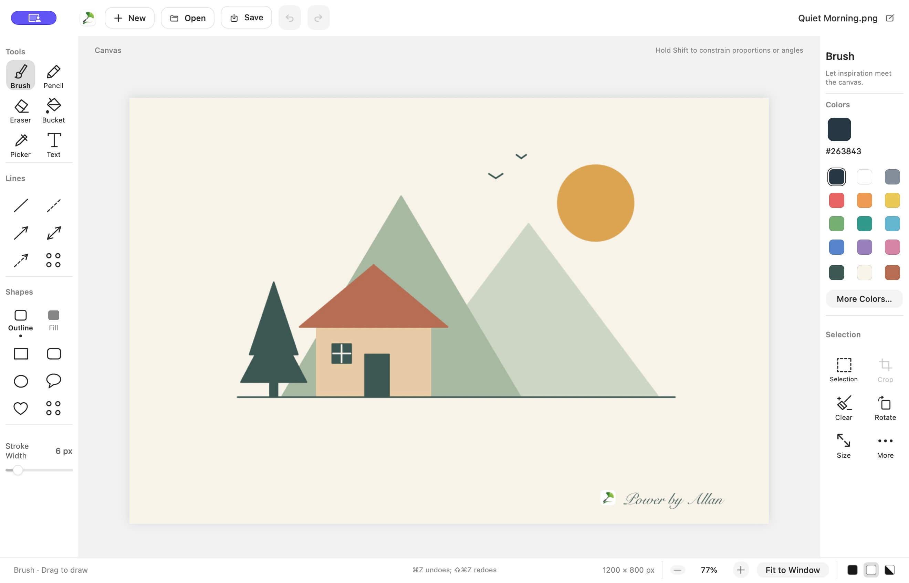

# 轻绘 · SimplePaint

[简体中文](readme_cn.md)



A simple paint app for macOS and the web, inspired by classic Windows Paint.

Draw a few lines, add some text, or make a quick edit. Familiar tools, and what you see is what you get.

The packaged macOS download is only **2 MB**. Requires macOS 13 or later.

## Projects

- `macos/`: native macOS app, Xcode project, resources, and build scripts.
- `web/`: browser version, built with HTML, CSS, and JavaScript. No dependencies or build step.
- `docs/`: shared screenshots and documentation assets.

### Web

Use [SimplePaint in your browser](https://jzlhll.github.io/MacSimplePaint/).

From the repository root, run:

```bash
python3 -m http.server 8080 --directory web
```

Open [http://localhost:8080](http://localhost:8080) in a current browser. The app can also be served by any static host. Images are processed locally in the browser; saving downloads PNG, JPEG, or WebP files. System clipboard access requires HTTPS or localhost and browser permission; the editor also keeps an internal clipboard.

The editor layout has a minimum size of **1200 × 800**; smaller browser windows can scroll. This is independent of the image dimensions, which default to 1200 × 800 pixels and can be changed. The status row sits below New/Open/Save, and appearance follows the browser by default, with manual light/dark overrides.

GitHub Pages serves the root of the `gh-pages` branch. For a web release, tag the source version and publish the files inside `web/` to that branch. Regular `main` pushes do not update the published app.

### macOS development

```bash
./macos/scripts/build.sh
./macos/scripts/run.sh
python3 macos/scripts/install_macos.py --skip-build
```

The build is written to `macos/build/SimplePaint.app`. Local signing configuration belongs in `macos/.local-signing.json`.

## Opening the downloaded app

SimplePaint currently uses a self-signed certificate instead of an official Apple Developer ID certificate, so macOS may block the downloaded app from opening.

After moving a trusted copy of SimplePaint to `/Applications`, run this command in Terminal to remove its quarantine attribute, then open it again:

```bash
sudo xattr -r -d com.apple.quarantine /Applications/SimplePaint.app
```

Enter your Mac login password when prompted (Terminal does not display password characters).
